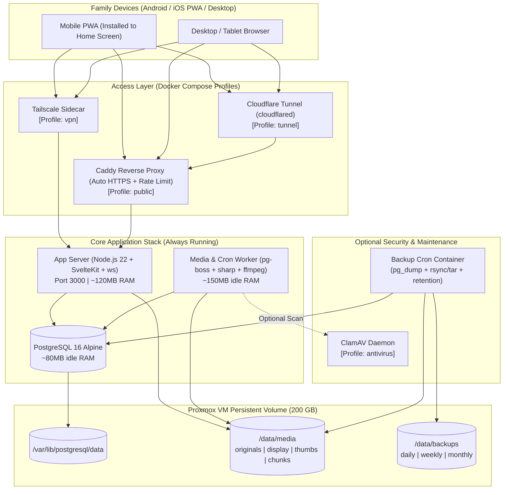

# FamilyGram ("Kinship") — Stage 1: System Architecture Document

## 1. Executive Summary & Target Environment

**FamilyGram** (working title: **Kinship**) is a self-hosted, private, family-only social network and photo/video vault designed as an installable Progressive Web App (PWA) for Android, iOS, and desktop browsers.

### Target Home Lab Hardware Profile
- **Host**: Desktop PC (16 GB RAM, 1 TB disk) running **Proxmox VE**.
- **Target VM**: Linux VM allocated **200 GB storage** (thin-provisioned or LVM/ext4, expandable via Proxmox) and 2–4 GB RAM.
- **Idle RAM Budget**: Target **< 450 MB total** across all core containers (well under the 2 GB ceiling).
- **Zero External SaaS**: All databases, media files, queues, and push notification dispatchers run locally inside Docker Compose.

---

## 2. Key Architectural Decisions & Justifications

| Area | Decision | Justification |
| :--- | :--- | :--- |
| **App Framework** | **SvelteKit (TypeScript) + Custom Node.js HTTP/WS Server** | SvelteKit compiles down to tiny, fast JS bundles ideal for low-end mobile phones used by elders/kids. Running via `adapter-node` wrapped in a custom Node server lets us serve the UI, REST API, chunked upload endpoints, signed media streams, and WebSocket (`ws`) connections in a single process (~90–140 MB RAM). |
| **Database** | **PostgreSQL 16 (Alpine)** + **Drizzle ORM** | Battle-tested relational integrity, native Full-Text Search (`tsvector` + GIN indexes for searching people, captions, tags, and albums), and JSONB support. Drizzle ORM is zero-overhead, type-safe, and generates clean SQL migrations. |
| **Background Queue** | **`pg-boss` (PostgreSQL-backed queue)** instead of Redis/BullMQ | Saves ~100–250 MB RAM and eliminates an extra stateful container (`redis`) to back up and monitor. `pg-boss` uses PostgreSQL `SKIP LOCKED` semantics to reliably schedule media transcoding (`sharp`/`ffmpeg`), 24h story expiration, nightly backup triggers, and "On This Day" memory generation. |
| **Media Storage** | **Local POSIX Filesystem on Mounted Docker Volume** instead of MinIO | On a single Proxmox VM with a 200 GB disk, MinIO adds significant RAM overhead (~250 MB+) and erasure-coding storage overhead without benefit. Storing files in a structured local volume (`/data/media/{originals,display,thumbs,hls,chunks}`) served through Node with `sendfile` + HMAC-signed URLs is faster, simpler to back up with `rsync`/`restic`, and directly inspectable. |
| **Media Worker** | **Dedicated Worker Process (`sharp` + `ffmpeg` + `exiftool-vendored`)** | Runs in a separate container (or isolated worker process with CPU/RAM limits in Docker Compose) so heavy 4K phone video transcoding never blocks HTTP/WebSocket responsiveness. |
| **Network & Access** | **Docker Compose Profiles: `public` (Caddy / Cloudflare Tunnel) & `vpn` (Tailscale)** | Supports non-technical family members joining via a normal HTTPS domain while allowing zero-open-port operation via Cloudflare Tunnel or Tailscale mesh VPN. |

---

## 3. System Topology & Access Modes



---

## 4. Data Model (ERD)

```mermaid
erDiagram
    USERS ||--o{ SESSIONS : has
    USERS ||--o{ PASSKEYS : registers
    USERS ||--o{ INVITES : creates
    USERS ||--o{ CHILD_APPROVED_CONTACTS : "is child / approved contact"
    USERS ||--o{ POSTS : authors
    USERS ||--o{ MEDIA_ITEMS : uploads
    USERS ||--o{ STORIES : posts
    USERS ||--o{ ALBUMS : creates
    USERS ||--o{ COMMENTS : writes
    USERS ||--o{ REACTIONS : gives
    USERS ||--o{ NOTIFICATIONS : receives
    USERS ||--o{ PUSH_SUBSCRIPTIONS : registers

    POSTS ||--|{ POST_MEDIA : contains
    MEDIA_ITEMS ||--o{ POST_MEDIA : attached_to
    POSTS ||--o{ COMMENTS : has
    POSTS ||--o{ REACTIONS : has
    POSTS ||--o{ POST_TAGS : tagged_with
    POSTS ||--o{ POST_MENTIONS : mentions

    STORIES ||--|| MEDIA_ITEMS : displays
    STORIES ||--o{ STORY_VIEWS : viewed_by
    USERS ||--o{ HIGHLIGHTS : curates
    HIGHLIGHTS ||--|{ HIGHLIGHT_ITEMS : includes
    STORIES ||--o{ HIGHLIGHT_ITEMS : saved_in

    ALBUMS ||--o{ ALBUM_CONTRIBUTORS : shared_with
    ALBUMS ||--o{ ALBUM_MEDIA : groups
    MEDIA_ITEMS ||--o{ ALBUM_MEDIA : in_album

    CONVERSATIONS ||--|{ CONVERSATION_MEMBERS : includes
    CONVERSATIONS ||--o{ MESSAGES : contains
    MESSAGES ||--o{ MESSAGE_MEDIA : attaches

    USERS {
        uuid id PK
        string email UK
        string username UK
        string password_hash
        string display_name
        string relationship_label "e.g. Mom, Cousin, Grandpa"
        string bio
        enum role "admin | member | child"
        uuid avatar_media_id FK
        string locale "en | hi | kn | ta"
        enum text_scale "normal | large | xlarge"
        enum theme "system | light | dark"
        boolean is_active
        timestamp created_at
    }

    CHILD_APPROVED_CONTACTS {
        uuid id PK
        uuid child_user_id FK
        uuid contact_user_id FK
        uuid approved_by_id FK
        timestamp created_at
    }

    INVITES {
        uuid id PK
        string code UK "Human-friendly code e.g. DIWALI-7K9P"
        string token_hash UK "One-time link token hash"
        enum assigned_role "member | child"
        string default_relationship_label
        uuid created_by_id FK
        uuid claimed_by_id FK
        timestamp expires_at
        timestamp claimed_at
    }

    MEDIA_ITEMS {
        uuid id PK
        uuid uploader_id FK
        enum type "image | video"
        enum status "uploading | processing | ready | failed | quarantined"
        string original_rel_path
        string display_webp_rel_path
        string display_avif_rel_path
        string thumb_rel_path
        string video_mp4_rel_path
        string video_hls_rel_path
        int width
        int height
        float duration_sec
        bigint size_bytes
        string mime_type
        string sha256
        string alt_text
        boolean keep_exif
        jsonb exif_data "Captured date, camera, GPS (private unless keep_exif=true)"
        timestamp taken_at "Used for On This Day memories"
        timestamp created_at
    }

    POSTS {
        uuid id PK
        uuid author_id FK
        text caption
        string location_name
        boolean keep_exif
        boolean is_archived
        tsvector search_vector "Indexed caption + location + tags"
        timestamp created_at
        timestamp updated_at
    }

    COMMENTS {
        uuid id PK
        uuid post_id FK
        uuid author_id FK
        uuid parent_comment_id FK "Self-ref for threaded replies"
        text body
        timestamp created_at
    }

    STORIES {
        uuid id PK
        uuid author_id FK
        uuid media_id FK
        string caption
        timestamp expires_at "created_at + 24 hours"
        timestamp created_at
    }

    ALBUMS {
        uuid id PK
        uuid owner_id FK
        string title
        text description
        uuid cover_media_id FK
        boolean is_shared "All members or selected contributors"
        tsvector search_vector
        timestamp event_date
        timestamp created_at
    }

    CONVERSATIONS {
        uuid id PK
        enum type "direct | group"
        string title "Nullable for 1:1 chats"
        uuid created_by_id FK
        timestamp last_message_at
        timestamp created_at
    }

    CONVERSATION_MEMBERS {
        uuid conversation_id PK,FK
        uuid user_id PK,FK
        uuid last_read_message_id FK "Drives read receipts"
        boolean muted
        timestamp joined_at
    }

    MESSAGES {
        uuid id PK
        uuid conversation_id FK
        uuid sender_id FK
        text body
        timestamp created_at
        timestamp deleted_at
    }
```



### Supporting Tables (Also in Schema)
- **`sessions`**: `id` (SHA-256 of session token), `user_id`, `ip_address`, `user_agent`, `expires_at`, `created_at`.
- **`passkeys`**: `id` (credential ID), `user_id`, `public_key`, `counter`, `transports`, `device_name`, `created_at`.
- **`password_resets`**: `id`, `user_id`, `token_hash`, `created_by_admin_id` (nullable), `expires_at`, `used_at`.
- **`post_media`**: `post_id`, `media_id`, `sort_order`.
- **`post_tags`**: `post_id`, `tag` (normalized lowercase string).
- **`post_mentions`**: `post_id`, `comment_id` (nullable), `mentioned_user_id`.
- **`reactions`**: `id`, `post_id`, `user_id`, `emoji` (`❤️`, `😂`, `😮`, `🙏`, `🎉`), `created_at` (unique per `post_id, user_id`).
- **`story_views`**: `story_id`, `viewer_id`, `viewed_at` (unique per `story_id, viewer_id`).
- **`highlights` & `highlight_items`**: Persistent story collections on a user's profile (`title`, `cover_media_id`, ordered `story_id`s).
- **`notifications`**: `id`, `recipient_id`, `actor_id`, `type` (`like`, `comment`, `mention`, `story`, `message`, `album_invite`, `child_contact_request`), `reference_id`, `read_at`, `created_at`.
- **`notification_preferences`**: Per-user toggles (in-app & web push) per notification category.
- **`push_subscriptions`**: Web Push VAPID endpoint, `p256dh`, `auth` keys per user device.
- **`reports`**: Content moderation queue (`reporter_id`, `target_type`, `target_id`, `reason`, `status`, `resolved_by_id`, `resolved_at`).
- **`backup_runs`**: Tracks automated and manual backup status, size, duration, and log snippet for the Admin Panel.

---

## 5. Child Account Safety Model

A `child` role account has strict server-enforced boundaries:
1. **Approved Circle Only**: A Child account can only see posts, stories, and profiles of—and exchange messages with—Admins, their designated Parents/Guardians, and family members explicitly added to `child_approved_contacts` by an Admin.
2. **Interaction Guard**: Even in shared family albums or group chats, if an unapproved user creates content or attempts to DM a Child account, the API filters or blocks the interaction.
3. **Follow/Contact Requests**: If a Child tries to view or message another family member not yet in their circle, an automatic approval request notification is sent to the Admins.
4. **No Location/EXIF Leakage**: Posts by a Child account always force `keep_exif = false` and strip GPS metadata.

---

## 6. API Outline

All endpoints require an authenticated session cookie (`HttpOnly`, `Secure`, `SameSite=Lax`) and CSRF token header (`X-CSRF-Token`) on state-changing requests, except `/api/auth/*` public entry points and `/api/health`.

### 6.1 Auth, Passkeys & Invites
- `POST /api/auth/signup` — Claim one-time invite code/token, create account.
- `POST /api/auth/login` — Email/username + password login (rate-limited: 5 attempts / 15 min per IP + account).
- `POST /api/auth/logout` — Revoke current session.
- `POST /api/auth/passkey/register-options` & `POST /api/auth/passkey/register-verify` — WebAuthn passkey registration.
- `POST /api/auth/passkey/login-options` & `POST /api/auth/passkey/login-verify` — Passwordless login.
- `POST /api/auth/password-reset/request` & `POST /api/auth/password-reset/confirm` — Self-service email reset or Admin-generated one-time reset link.

### 6.2 Media Upload & Signed Delivery
- `POST /api/media/uploads` — Initialize a chunked upload (`filename`, `mimeType`, `sizeBytes`, `totalChunks`, `keepExif`, `altText`). Returns `uploadId` and `mediaId`.
- `PATCH /api/media/uploads/:uploadId` — Upload a chunk (`Content-Range` / chunk index). Supports resuming interrupted video uploads on flaky mobile connections.
- `POST /api/media/uploads/:uploadId/complete` — Finalize chunks, verify SHA-256/magic bytes, enqueue `pg-boss` processing job.
- `GET /api/media/:mediaId/:variant` — (`variant`: `thumb` | `webp` | `avif` | `mp4` | `hls` | `original`). Requires valid HMAC signature query parameters (`?exp=...&sig=...`) tied to the active session or short-lived token, supporting `Range` requests for smooth video scrubbing.

### 6.3 Feed, Posts, Comments & Reactions
- `GET /api/feed?cursor=...&limit=15` — Strictly chronological feed (filtered by Child circle if user is `child`).
- `POST /api/posts` — Create post with ordered `mediaIds[]`, `caption`, `tags[]`, `@mentions`, optional `locationName`, `keepExif`.
- `PATCH /api/posts/:id` / `DELETE /api/posts/:id` — Edit caption/tags/alt-text or delete (author or admin).
- `POST /api/posts/:id/reactions` — Toggle emoji reaction (`❤️`, `😂`, `😮`, `🙏`, `🎉`).
- `GET /api/posts/:id/comments` & `POST /api/posts/:id/comments` — Threaded comments (`parentCommentId`) with `@mention` parsing.
- `POST /api/reports` — Report a post, comment, or message to family admins.

### 6.4 Stories & Highlights
- `GET /api/stories/tray` — Active stories (< 24h old) grouped by family member, sorted with unviewed first.
- `POST /api/stories` — Publish photo/video story.
- `POST /api/stories/:id/view` — Record story view (`story_views`) and return viewer list to author.
- `POST /api/highlights` & `PATCH /api/highlights/:id` — Save any of a user's stories (even after 24h expiry, since story media is retained for archiving/highlights unless deleted) to profile Highlights.

### 6.5 Albums & "On This Day" Memories
- `GET /api/albums` & `POST /api/albums` — List or create shared albums (e.g., "Diwali 2026", "Grandma's 80th").
- `POST /api/albums/:id/items` — Add existing or newly uploaded media items (by owner or invited contributors).
- `GET /api/albums/:id/download.zip` — Streams an on-the-fly uncompressed ZIP (`store` mode via `archiver`) of original-quality photos/videos so RAM usage stays flat even for a 5 GB album.
- `GET /api/memories/on-this-day` — Queries posts and media items whose `taken_at` or `created_at` matches today's month and day from prior years.

### 6.6 Profiles & Family Relationships
- `GET /api/users/:username` — Profile metadata, `relationship_label` badge (e.g., "Nani", "Chacha", "Cousin"), Highlights bar, and paginated post grid.
- `PATCH /api/users/me` — Update avatar, bio, `relationship_label`, language (`en`, `hi`, `kn`, `ta`), text size (`normal`, `large`, `xlarge`), and theme.

### 6.7 Direct & Group Messages + WebSockets
- `GET /api/conversations` & `POST /api/conversations` — List or start 1:1 or group chats.
- `GET /api/conversations/:id/messages?cursor=...` & `POST /api/conversations/:id/messages` — Fetch history or send text + photo/video message.
- `POST /api/conversations/:id/read` — Update `last_read_message_id` and broadcast read receipt.
- `WS /api/ws` — Authenticated WebSocket multiplexing:
  - `chat:message` (new message in real time)
  - `chat:typing` (ephemeral typing indicator)
  - `chat:read` (live read receipt update)
  - `notification:new` (live badge increment for likes/comments/stories)
  - `media:status` (notifies uploader when background video transcoding finishes)

### 6.8 Notifications & Web Push
- `GET /api/notifications` & `POST /api/notifications/mark-read` — Activity feed.
- `GET /api/push/vapid-public-key` & `POST /api/push/subscribe` — Register PWA Service Worker for native Web Push (Android Chrome/Firefox + iOS 16.4+ Home Screen Web Apps).
- `PATCH /api/notifications/preferences` — Granular per-user notification toggles.

### 6.9 Search
- `GET /api/search?q=...&type=all|people|posts|tags|albums` — PostgreSQL Full-Text Search + prefix trigram matching across family members (`display_name`, `username`, `relationship_label`), post captions, `#tags`, and album titles.

### 6.10 Admin Panel
- `GET /api/admin/overview` — Disk space usage on the 200 GB VM (used/free/media breakdown), user count, queue health, and last backup status.
- `POST /api/admin/invites` & `DELETE /api/admin/invites/:id` — Create/revoke one-time invite links & codes.
- `PATCH /api/admin/users/:id` — Change role (`admin`, `member`, `child`), deactivate user, generate password reset link, or manage `child_approved_contacts`.
- `GET /api/admin/reports` & `PATCH /api/admin/reports/:id` — Moderate reported content.
- `POST /api/admin/backups/trigger` — Trigger an immediate backup job and view backup history.

---

## 7. Media Processing Pipeline & Storage Layout

### On-Disk Directory Structure (`/data/media`)
```text
/data/media/
├── chunks/          # Temporary upload chunks (cleaned after assembly or 24h TTL)
├── originals/       # Immutable original files: YYYY/MM/<mediaId>.<ext>
├── display/         # EXIF-stripped WebP & AVIF (max 1920px) + H.264 MP4 (720p/1080p faststart)
├── hls/             # Optional adaptive HLS segments for videos > 60 seconds
└── thumbs/          # 400x400 WebP square & aspect-ratio thumbnails + video poster frames
```

### Processing Workflow (`pg-boss` Worker)
1. **Validation & Optional Virus Scan**: Check file magic bytes (`file-type`), enforce size limits (e.g., 50 MB per photo, 2 GB per video), and optionally pass stream to ClamAV (`clamd`) if enabled.
2. **EXIF Extraction & Privacy Stripping**:
   - Read capture date (`DateTimeOriginal`) so old family photos uploaded later still appear accurately in "On This Day" memories.
   - Strip all EXIF/GPS tags from generated `display/` and `thumbs/` files by default. Originals remain untouched in `originals/` (only downloadable by authorized users or album ZIP exports).
3. **Image Pipeline (`sharp`)**:
   - Auto-orient based on EXIF rotation.
   - Generate `400px` WebP thumbnail (`thumbs/`).
   - Generate `1920px` max-dimension WebP and AVIF (`display/`).
4. **Video Pipeline (`ffmpeg`)**:
   - Extract poster frame at `t=00:00:01` -> `sharp` -> `thumbs/`.
   - Transcode to web-compatible H.264 MP4 (`-c:v libx264 -preset veryfast -crf 23 -pix_fmt yuv420p -c:a aac -movflags +faststart`) capped at 1080p so every iPhone and Android plays it natively.
   - For videos > 60 seconds, generate an HLS playlist (`master.m3u8` + `.ts`/`.m4s` segments) for instant adaptive playback.

---

## 8. Repository & Folder Structure

```text
instagram/
├── docker-compose.yml              # Core stack + profiles (public, tunnel, vpn, antivirus)
├── .env.example                    # Documented environment template
├── Caddyfile                       # Reverse proxy, security headers, automatic HTTPS
├── Dockerfile                      # Multi-stage build for App & Worker (Node 22 + ffmpeg)
├── package.json
├── tsconfig.json
├── drizzle.config.ts
├── docs/
│   └── ARCHITECTURE.md             # This architecture specification
├── scripts/
│   ├── backup.sh                   # Nightly pg_dump + media sync + retention pruning
│   ├── restore.sh                  # Interactive & automated restore script
│   └── seed.ts                     # Demo family data seeder (Grandma, Parents, Cousins, Kids)
├── src/
│   ├── app.html
│   ├── app.css                     # Tailwind CSS + dark/light + large text scale variables
│   ├── service-worker.ts           # Offline shell caching + Web Push event listener
│   ├── hooks.server.ts             # Auth session validation, CSRF, CSP, noindex headers, rate limit
│   ├── lib/
│   │   ├── i18n/                   # English (en) + Hindi (hi), Kannada (kn), Tamil (ta) dictionaries
│   │   ├── server/
│   │   │   ├── db/                 # Drizzle schema.ts, relations.ts, migrate.ts, index.ts
│   │   │   ├── auth/               # Argon2id, sessions, WebAuthn passkeys, invites, child-guard
│   │   │   ├── media/              # Chunked upload handler, HMAC URL signer, sharp/ffmpeg worker
│   │   │   ├── queue/              # pg-boss job definitions & schedules
│   │   │   ├── ws/                 # WebSocket hub for real-time chat & notifications
│   │   │   └── push/               # Web Push VAPID notifications dispatcher
│   │   └── components/             # Accessible, mobile-first Svelte UI components
│   │       ├── layout/             # BottomNav, TopBar, ThemeTextToggle
│   │       ├── stories/            # StoriesTray, StoryViewerModal, HighlightPicker
│   │       ├── feed/               # PostCard, MediaCarousel, CommentSheet, ReactionBar
│   │       ├── upload/             # ChunkedUploader with progress bar & alt-text prompt
│   │       ├── albums/             # AlbumGrid, MemoriesBanner
│   │       └── chat/               # ConversationList, MessageThread, ReadReceipts
│   └── routes/
│       ├── (auth)/                 # /login, /invite/[code], /reset-password
│       ├── (app)/                  # Protected routes
│       │   ├── +page.svelte        # Home (Stories bar +On This Day banner + Chronological Feed)
│       │   ├── search/             # Search people, captions, #tags, albums
│       │   ├── create/             # New Post / Story / Album uploader
│       │   ├── activity/           # Notifications & Child contact requests
│       │   ├── messages/           # 1:1 & Group chats
│       │   ├── albums/             # Shared albums & ZIP download
│       │   ├── profile/[username]/ # Avatar, Relationship badge, Highlights, Post grid
│       │   └── admin/              # Invites, Users, Child safety, Storage gauge, Backups, Reports
│       └── api/                    # REST & Media streaming endpoints
└── tests/
    ├── unit/                       # Vitest unit tests (auth, child visibility, signed URLs, i18n)
    └── e2e/                        # Playwright E2E flows (invite signup -> post -> comment -> chat)
```

---

## 9. Staged Delivery Roadmap

- **Stage 1 (Current)**: Architecture document (`docs/ARCHITECTURE.md`) — *Paused for your review*.
- **Stage 2**: Project scaffold with Docker Compose (`app`, `worker`, `db`, `caddy`, `backup`), Drizzle setup, i18n/theme/accessibility shell, and end-to-end "Hello World" health check.
- **Stage 3**: Core Features Implementation:
  - *3a*: Auth, Invite links/codes, Roles (`admin`, `member`, `child`), Passkeys, Rate limiting.
  - *3b*: Media pipeline (chunked uploads, EXIF stripping, `sharp`/`ffmpeg` worker, HMAC signed URLs) + Feed, Posts, Reactions, Threaded Comments, `@mentions`.
  - *3c*: 24-hour Stories, Viewer list, Highlights, Shared Albums, ZIP download, "On This Day" memories.
  - *3d*: 1:1 & Group Chat (WebSockets + read receipts), In-App & Web Push Notifications, Full-Text Search, and Admin Panel (Users, Invites, Storage gauge, Reports, Backups).
- **Stage 4**: Automated Tests (Vitest unit tests + Playwright E2E flows) and Demo Family Seed Script (`scripts/seed.ts`).
- **Stage 5**: Comprehensive `README.md` covering Proxmox VM setup, Cloudflare Tunnel vs. Tailscale VPN setup, automated backups & tested restore procedure, upgrades, and step-by-step Android/iOS PWA installation guides for family members.
